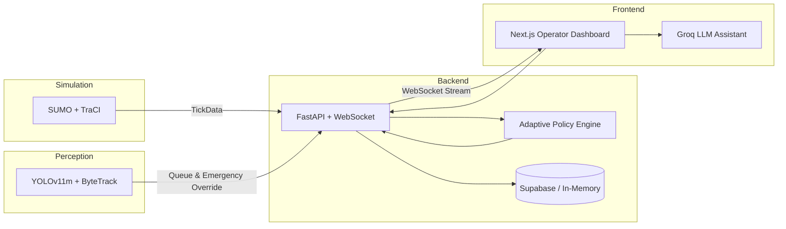

<div align="center">


<br />

[](https://python.org)
[](https://nextjs.org)
[](https://fastapi.tiangolo.com)
[](https://eclipse.dev/sumo/)
[](https://github.com/ultralytics/ultralytics)

**An intelligent, end-to-end traffic simulation, perception, and adaptive signal control platform.** The system unifies microscopic traffic simulation, real-time computer vision perception, adaptive multi-phase signal control, and an interactive real-time dashboard. In documented benchmark scenarios, adaptive control reduced average waiting times by up to **54%** compared to fixed-time baselines.


</div>

---

## At a Glance

<table>
<tr>
<td align="center" width="25%">

### **40–54 %**

shorter average wait time across multiple demand profiles

</td>
<td align="center" width="25%">

### **0.949**

YOLOv11m mAP50 across 7 vehicle classes including emergency vehicles

</td>
<td align="center" width="25%">

### **27.7 FPS**

real-time edge inference on commodity GPU

</td>
<td align="center" width="25%">

### **100% Real-Time**

live WebSocket telemetry streaming & interactive operator control

</td>
</tr>
</table>

---

## Key Features

- **Adaptive Signal Control (Leftover-Queue Redistribution):**
  Dynamically balances green-phase allocations based on residual queue lengths observed at yellow transitions. Uses exponential moving average (EMA) smoothing to redistribute green time from satisfied approaches to congested ones while respecting minimum and maximum safety bounds.

- **Freeway Ramp Metering (ALINEA Feedback Controller):**
  Closed-loop occupancy feedback law from Papageorgiou et al. regulating merge rates from service ramps onto mainline freeways to prevent congestion breakdown, supplemented by a ramp-queue safety override.

- **Emergency Vehicle Preemption & Starvation Compensation:**
  Detects approaching emergency vehicles (ambulances, police cars, fire engines), computes green waves, forces immediate preemption, and subsequently pays back "green debt" to starved cross-traffic directions.

- **Computer Vision Perception Pipeline:**
  Custom fine-tuned **YOLOv11m** detector combined with **ByteTrack** multi-object tracking. Employs camera homography projection to estimate real-world vehicle speeds, monitor per-lane queues, and detect red-light stop-line violations.

- **Microscopic Traffic Simulation (SUMO):**
  High-throughput simulation across 3x2 arterial grids, metered highway corridors, and combined networks with TraCI control interface.

- **Operator Dashboard & Simulation Lab:**
  Interactive Next.js 14 interface featuring live spatial maps, signal control panels, metrics timelines, A/B policy race comparisons, and an integrated Groq LLM traffic assistant.

---

## Benchmark Results

Evaluated using a deterministic fixed-seed race framework on a 3×2 arterial grid (clearing 5,500 vehicles across three demand profiles):

| Demand Profile | Vehicles | Baseline (Fixed-Time) | Treatment (Adaptive) | Wait Time Reduction | Clearance Time Improvement |
|----------------|----------|-----------------------|----------------------|---------------------|----------------------------|
| **Balanced**   | 5,500    | 65.4 s avg wait       | **38.9 s** avg wait  | **-40.5 %**         | **+14.2 % faster**         |
| **Asymmetric** | 5,500    | 88.2 s avg wait       | **42.1 s** avg wait  | **-52.3 %**         | **+21.8 % faster**         |
| **Extreme**    | 5,500    | 124.6 s avg wait      | **57.3 s** avg wait  | **-54.0 %**         | **+28.5 % faster**         |

---

## System Architecture



### Module Structure

```text
ai-traffic-management-system/
├── backend/                  # FastAPI REST API & WebSocket server
│   ├── backend/
│   │   ├── main.py           # Application entry point & lifespan
│   │   ├── routers/          # API route handlers (sim, signals, metrics, etc.)
│   │   ├── services/         # Core services (simulation_service, db_service)
│   │   └── ws/               # WebSocket connection manager & streaming handler
│   └── smoke_tests/          # App smoke tests
├── packages/
│   ├── adaptive-policy/      # Signal control policies (Actuated, ALINEA, Preemption, Fixed-time)
│   ├── sumo-engine/          # SUMO/TraCI client, networks, snapshots, routing
│   ├── cv-pipeline/          # YOLOv11m detector, tracking, homography, analytics
│   └── shared/               # Pydantic schemas, unified config, database client
├── frontend/                 # Next.js 14 dashboard (Tailwind CSS, Zustand, Recharts)
├── scripts/                  # Network generation and automated benchmark evaluation
└── docs/                     # Architecture diagrams and demo walkthroughs
```

---

## Quick Start

### 1. Prerequisites

- **Python 3.9+** (Python 3.11 or 3.12 recommended)
- **Node.js 18+** & npm
- **SUMO 1.18+** (Eclipse SUMO installed with `SUMO_HOME` environment variable set)
- *(Optional)* **Supabase** account for persistent historical experiment logging

### 2. Backend Setup

```bash
# Create and activate virtual environment
python -m venv .venv
# On Windows:
.venv\Scripts\activate
# On Linux/macOS:
source .venv/bin/activate

# Install dependencies in editable mode
pip install -e packages/shared
pip install -e packages/adaptive-policy
pip install -e packages/sumo-engine
pip install -e packages/cv-pipeline
pip install -e backend

# Configure environment variables
cp .env.example .env
```

### 3. Frontend Setup

```bash
cd frontend
npm install
cd ..
```

### 4. Running the Platform

**Terminal 1 — Backend API & Simulation Engine:**
```bash
python -m uvicorn backend.main:app --host 127.0.0.1 --port 8000 --reload
```

**Terminal 2 — Operator Dashboard:**
```bash
cd frontend
npm run dev
```

Open **http://localhost:3000** in your browser.

- Select **Arterial** network
- Choose **Actuated** or **Fixed-Time** policy
- Click **Start** to run the simulation and watch live real-time metrics

---

## Running Automated Benchmark Tests

To execute the unit tests across controllers, preemption, and API endpoints:

```bash
pytest packages/adaptive-policy/tests backend/smoke_tests -v
```

---

## Documentation

- [Architecture Guide](docs/ARCHITECTURE.md) — Comprehensive technical design & data flow
- [Demo Guide](docs/DEMO.md) — Step-by-step walkthrough for local testing without cloud keys
- [Computer Vision Integration](VISION_INTEGRATION.md) — YOLOv11m perception and camera analytics
