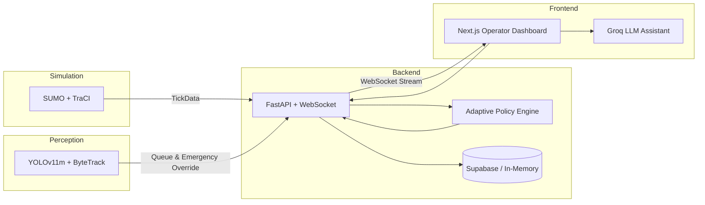

# Architecture Overview

High-level architecture and data flow of the AI Traffic Management & Monitoring System.

## Data Flow

## Package Responsibilities

| Package | Role |
|---------|------|
| `sumo-engine` | TraCI client, network topology, snapshot extraction, emergency vehicle routing |
| `adaptive-policy` | Leftover-queue actuated control, fixed-time baseline, ALINEA ramp-metering, emergency preemption |
| `cv-pipeline` | YOLOv11m detector, ByteTrack multi-object tracking, speed estimation, queue counts, red-light violations |
| `shared` | Pydantic data models, unified configuration, constants, and database client |
| `backend` | FastAPI REST & WebSocket streaming server, simulation life-cycle manager |
| `frontend` | Next.js operator dashboard, simulation lab, policy playground, and live map view |

## Runtime Mode

| Mode | Simulation Engine | Perception Source |
|------|-------------------|-------------------|
| **SUMO** | TraCI microscopic simulation | Ground truth telemetry + optional YOLOv11m vision perception pipeline |

## API Surface

- **REST API:** `http://localhost:8000/api` — simulation controls, signals, metrics, policy variants, experiments
- **OpenAPI Docs:** `http://localhost:8000/docs` (interactive Swagger UI)
- **WebSocket:** `ws://localhost:8000/ws/traffic` — real-time continuous `TickData` broadcast stream

## Persistence Layer

PostgreSQL (via Supabase) persists simulation runs, per-tick metric logs, policy variants, and comparison experiments. Writes are asynchronously queued and buffered in memory so the high-frequency simulation loop never blocks on external network I/O. If database credentials are not configured, the system degrades seamlessly to local in-memory operation.
